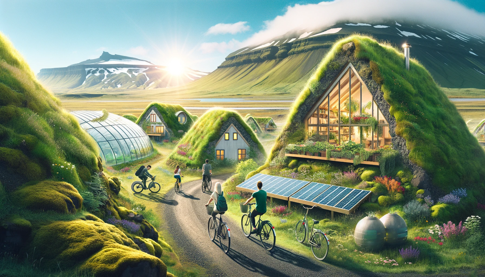

The Icelandic word for sustainability, *sjálfbærni*, closely mirrors the word for independence,
*sjálfstæði* — self-sufficiency and resilience, side by side. That idea runs through everything
below.

Iceland has emerged as a global leader in sustainable development through pioneering renewable
energy and environmental policy. The story has two complementary sides: **local governments**
that create the policy frameworks and infrastructure, and **small enterprises** that drive
practical, on-the-ground innovation — a model other small nations and communities can learn
from.

## Iceland by the numbers

- 100% of electricity from renewables (≈73% hydropower, 27% geothermal); around 85% of total
  primary energy renewable
- A national goal of carbon neutrality by 2040 — a decade ahead of many nations
- 72 municipalities piloting local climate action — from Reykjavík to Akureyri, Vestmannaeyjar
  and Höfn
- Reykjavík's cycling network: 45+ km of paths and ~12,000 tonnes of CO₂ avoided each year
- Pioneering carbon capture (CarbFix) and geothermal innovation in food, wellness and industry

## Why it matters for small communities

None of this came from being large. It came from building sustainability around the resources a
place already has, and from local institutions small enough to act quickly. That is a far more
transferable lesson than any single technology — and it is the thinking behind much of Circa's
own work.

## Explore further

- [Sustainable Iceland — Government of Iceland](https://www.government.is/topics/sustainable-iceland/)
- [Reykjavík and climate](https://reykjavik.is/en/reykjavik-and-climate)
- [Vakinn — Iceland's responsible-tourism certification](https://www.vakinn.is/en/about-vakinn)
- [Energy in Iceland — overview](https://en.wikipedia.org/wiki/Energy_in_Iceland)
